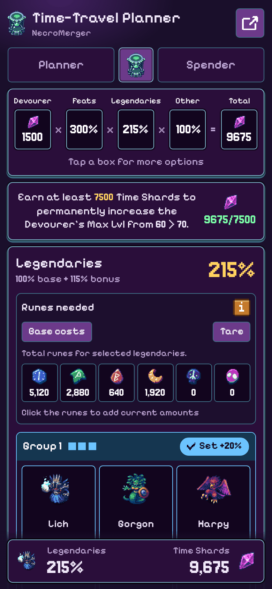
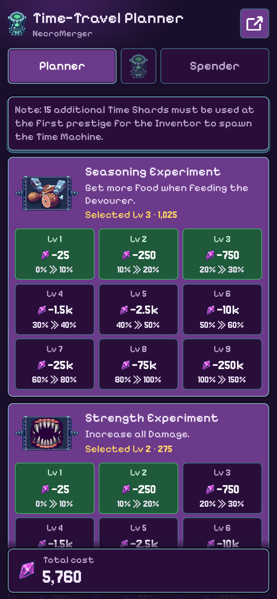
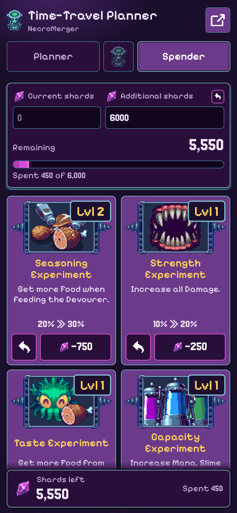
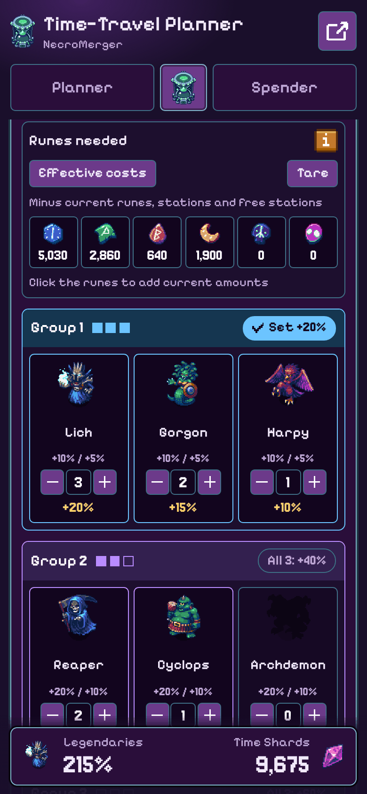
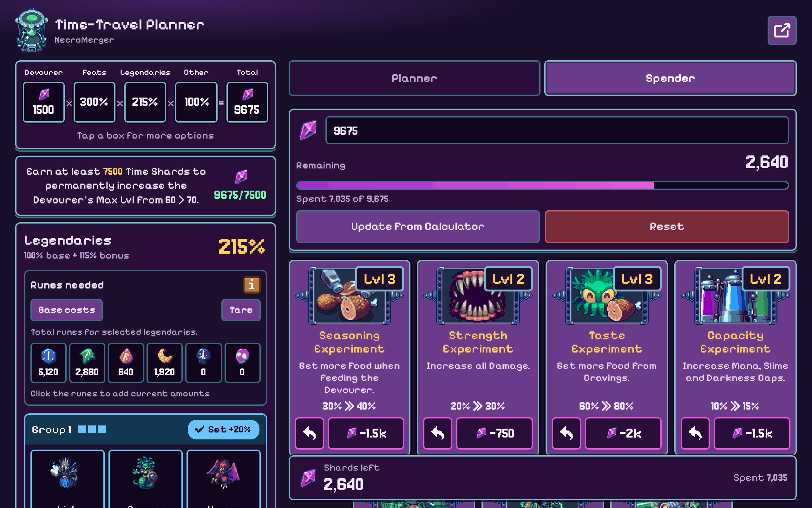
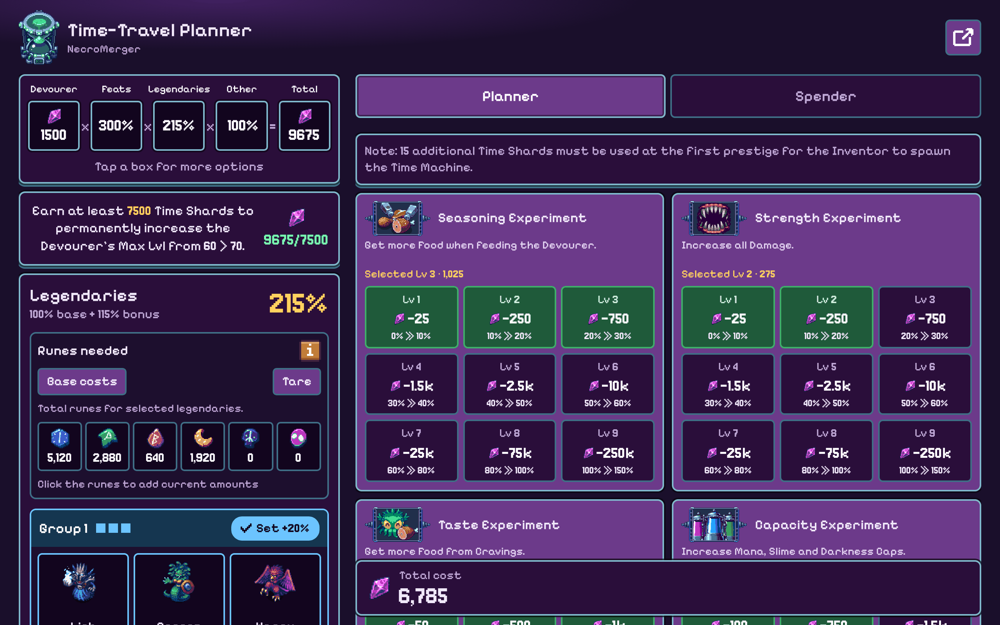

# Time-Travel Planner for NecroMerger
> NecroMerger players can plan their Time Shard spending, and the legendaries and runes behind it, in one place instead of juggling several calculators and spreadsheets.

[](LICENSE)
[](https://dvynsh3.github.io/TimeTravel-Planner-NM/)
[](../../releases)

**Try it:** https://dvynsh3.github.io/TimeTravel-Planner-NM/  ·  **Status:** active  ·  **Platform:** browser, mobile first; installable to the home screen

<!-- SCREENSHOT: hero -->
<p align="center"></p>

> Unofficial fan project. Not affiliated with or endorsed by the NecroMerger developers.

## Why this exists
- **Who:** NecroMerger players about to prestige who need to decide how to spend Time Shards at the Inventor.
- **Before:** the work was split across the in-game calculator, a community planner for experiment costs, and a community spreadsheet for shard yield and runes. That meant disconnected tools, inputs in different formats and separate results that were confusing to read. By my own rough, unmeasured estimate it took at least four to five times as long, and mistakes crept in.
- **Now:** one page covers what to buy, how many shards a run gives, how many legendaries to make and what runes they cost. The whole setup travels in a link, which is easy to share on the community subreddit and Discord servers and to keep for later.

## What it does
- **Plan a purchase list:** pick experiment levels and see the total shard cost and which inventions it unlocks, with a progress bar towards the next one.
- **Spend a budget:** enter your current shards and the additional shards you expect (it can follow the calculator), tap experiments to buy them level by level, and be stopped before you overspend.
- **Estimate shard yield:** combine Devourer max level, feat tier, legendaries and "Other" %, with a full breakdown and the amount needed to advance a level.
- **See how many legendaries fit:** a counter such as (9/40) tracks the legendaries you chose against the tile limit for your run, with Store-O and Unstable Rift selectable.
- **Plan legendaries and runes:** see the runes your legendaries need, including free stations (Effective costs) and a Tare button for what you already own.
- **Record what you hold:** enter runes and max-level stations you already have so the counts shrink to what is still needed.
- **Share a setup:** copy a link, or export a PNG dashboard that carries your save inside it. Load back either by pasting, uploading or dragging the image onto the page.
- **Work with the community planner:** paste a Drallieiv Helper link to load its selection, or open the helper with your current picks.
- **Avoid spoilers:** Level 100+ experiments, dropdown rows and feat tiers stay hidden until you turn spoilers on.

<!-- SCREENSHOT: key flow -->
<p align="center">



</p>
<p align="center"><sub>Left to right: plan a purchase list, spend a budget, work out the runes.</sub></p>

On a wide screen the calculator stays on the left while the spender or planner fills the right:





## Quick start
1. Open the live site on a phone or computer.
2. Tap **Planner**, then tap a level on any experiment. Every level before it gets selected too.
3. Check the **Total cost** at the bottom and the inventions unlocked.
4. Open the hourglass (calculator) tab, choose a Devourer max level, and add your legendaries with the + buttons.
5. Result: the Time Shards total at the bottom updates live, and the runes needed appear in the legendaries card.
6. Optional: use the Tare button to account for the legendaries you already have in your lair, and tap the runes to enter your current runes and max-level stations.

On a phone, use your browser's "Add to Home Screen" for an app-like icon.

## Decisions and trade-offs
| Decision | Over | Because |
|---|---|---|
| One static HTML file | A hosted app or app-store build | It can be hosted free and added to the home screen. |
| The share link carries the whole setup | A separate code to copy and paste | The link is the thing people actually share and open. |
| A compact packed save string | Readable text | It had to stay short enough for links and PNG filenames. |
| Level 100+ content hidden by default | Showing everything | The game contains spoilers past level 100. |
| Read and write Drallieiv Helper links | Own format only | Selections carry across both tools. |
| Check results against community sources | Trusting my own formulas | See Evidence. |

**What I left out on purpose**
- **Predicting shards earned per run:** the game's randomness makes it unreliable.
- **Previous-run invention progress:** built, then removed, because earlier runs' spend does not count towards it.
- **Other % from Timepieces, and chest and golem planning:** both exist in the community spreadsheet. I left them out deliberately and most probably will not add them. The in-game calculator already shows the exact contribution from other sources, the user can just input that as is, instead of each individual piece contributing to the final amount.
- **Only max-level stations are tracked:** Other stations at varying levels that you already own must be added by hand as runes. Chose to take this route to limit the number of inputs from user, a combined rune count is easier to input and re-input when trying multiple builds than entering all stations again.

## Known limits
- The Cursed, Colossus and Infernal cost the full sum of their two ingredients. Using up the Lich, Reaper and so on is not modelled yet; you need to lower those counts yourself.
- "Other" % is typed in, not worked out.
- Exporting a PNG may not download inside some in-app browsers. Use a normal browser.
- Tested on Chrome, Firefox and Safari. Game names and art belong to the NecroMerger developers (see THIRD_PARTY_NOTICES.md).
- Where this tool differs from UncleMumble's spreadsheet: level 40 base shards are 275 here (confirmed in game; the sheet returns a different value because of a lookup error), and Split-O costs 20,000 (from the in-game screen) where the sheet says 25,000.

## Privacy and data
- Your setup is saved in your browser (local storage) on your own device.
- The page makes no network requests of its own after loading: no analytics, no accounts, no external fonts.
- A link or PNG contains your setup but nothing is uploaded anywhere. The Load button reads the clipboard only when you tap it.
- Links to the wiki, Drallieiv Helper and the spreadsheet open other sites.
- Works offline after the first load. It is served by GitHub Pages.

## Evidence
- 69 of 69 comparable random setups matched UncleMumble's spreadsheet Time Shard total exactly, and 48 of 48 matched its base rune totals, measured by an automated browser test against a LibreOffice recalculation of the sheet, on 2026-11-25, n=74 setups (5 level-40 setups excluded because of the sheet's lookup error). The test allowed for the Soul Stalker inconsistency in the spreadsheet. I also checked the shard amounts in the app against my own max level 50 and max level 60 runs.
- No usage numbers collected yet.

## Version history
Latest: **v2.0.3** (2026-11-28). Full detail in [CHANGELOG.md](CHANGELOG.md) and [Releases](../../releases).
| Version | Date | What changed for the user |
|---|---|---|
| v1.0.0 | 2026-11-21 | First public site: installable, works offline |
| v1.2.0 | 2026-11-21 | The link carries the whole setup |
| v1.3.0 | 2026-11-21 | Desktop two-column layout |
| v1.6.0 | 2026-11-23 | Level 100+ options, rune stock, legendary limits |
| v1.9.0 | 2026-11-25 | Free-station rune costs follow the game |
| v2.0.0 | 2026-11-27 | Legendary tile limit counter and current shards in the Spender |

Earlier versions are archived builds restored from local backups; the source at each tag is the repository snapshot at upload, not the original code for that version. The v0.x entries in the changelog describe builds that no longer exist as files.

## Feedback
Many of the changes after v1.0.0 came from feedback by at least six community members on Discord and Reddit (names withheld; counted by me). To report a problem or an idea, open an [issue](../../issues). Useful to include: the link or PNG of your setup, what you expected, and your phone or browser.

## How this was built
I own the problem, scope, trade-offs and testing: I specified the features, directed the work, checked it against the game, the wiki and community tools, and tested it on my phone. Claude (Anthropic) wrote much of the implementation, including the automated checks. I designed, directed, tested and shipped it.

<details>
<summary>Run locally and files</summary>

It is a single static page with no build step.

```bash
python3 -m http.server 8000
# then open http://localhost:8000
```

Opening `index.html` directly also works, but offline support only activates over http(s).

| File | Purpose |
|---|---|
| `index.html` | The whole app (code, data, fonts and images in one file) |
| `manifest.webmanifest`, `icon-*.png`, `apple-touch-icon.png` | Home-screen install support |
| `sw.js` | Offline support |
| `og-image.png` | Link preview image |
| `docs/screenshots/` | Images used in this README |
| `.nojekyll` | Tells GitHub Pages to serve files as they are |
| `LICENSE`, `THIRD_PARTY_NOTICES.md` | Licences and credits |

</details>

## Credits
- Game data and art: the [NecroMerger Wiki](https://necromerger.wiki.gg/) and the game itself.
- [Drallieiv Helper](https://drallieiv.github.io/NecroMerger-Inventor/): initial inspiration, link format compatibility, and a reference for experiment data.
- [UncleMumble's Time Shard calculator spreadsheet](https://docs.google.com/spreadsheets/d/1Ug5sJjNoo6mfVeCaRA4wmGCiYNOfYy8OiheXtA-aV3E/edit?usp=sharing): reference for the Time Machine formulas and rune costs.
- Fonts: Pixelify Sans and Jersey 10 (SIL Open Font License 1.1).

See [THIRD_PARTY_NOTICES.md](THIRD_PARTY_NOTICES.md) for details.

## Licence
MIT. See [LICENSE](LICENSE). Copyright (c) 2026 dvynsh3.
